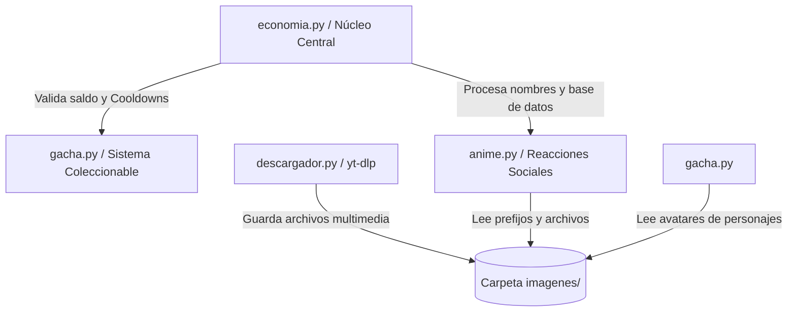

# 🌟 Ciel Bot Místico - Documentación y Guía del Repositorio

> **Bot modular de automatización y entretenimiento para WhatsApp** impulsado con economía virtual, sistema Gacha de personajes de anime/ciencia, reacciones multimedia interactivas y motor de descargas de redes sociales.

---

## 📋 Tabla de Contenidos
1. [Descripción General](#-descripción-general)
2. [Estructura y Arquitectura del Repositorio](#-estructura-y-arquitectura-del-repositorio)
3. [Explicación Detallada de Archivos](#-explicación-detallada-de-archivos)
4. [Relación e Interconexión entre Módulos](#-relación-e-interconexión-entre-módulos)
5. [Método de Instalación y Despliegue](#-método-de-instalación-y-despliegue)
6. [Guía de Comandos Rápidos](#-guía-de-comandos-rápidos)

---

## 🎯 Descripción General

**Ciel Bot Místico** es un proyecto de desarrollo backend en Python diseñado para operar como un bot interactivo multifuncional. Su arquitectura se divide de manera modular para separar la lógica de negocio económica, la invocación de coleccionables (*Gacha*), la manipulación multimedia orientada a redes sociales y las respuestas visuales de rol/anime con envío automático de imágenes locales.

---

## 📂 Estructura y Arquitectura del Repositorio

El proyecto se compone de cuatro archivos principales en el directorio raíz y una carpeta auxiliar de recursos multimedia:

```text
📦 repositorio-ciel-bot/
 ┣ 📜 anime.py           # Módulo de interacciones sociales y reacciones visuales de anime.
 2 ┣ 📜 descargador.py     # Motor de descargas multimedia (YouTube, TikTok, Instagram, Facebook).
 3 ┣ 📜 economia.py        # Núcleo financiero, base de datos de usuarios, minijuegos y comandos globales.
 4 5 ┗ 📜 gacha.py           # Sistema de invocación, inventario, mercado y colección de personajes.
```

---

## 🔍 Explicación Detallada de Archivos

### 1. `economia.py` — El Corazón Financiero y Central
* **¿Qué hace?** Actúa como el controlador principal del sistema. Gestiona la base de datos en memoria/diccionarios de los usuarios, controla los tiempos de espera (*cooldowns*) de los comandos de trabajo y delitos, administra los saldos en efectivo y banco, y aloja la tabla general de ayuda (`#help`) y comandos del sistema central (`#on`, `#off`).
* **Funciones Clave:**
  * `#work`, `#slut`, `#crime`: Mecánicas de obtención de recursos económicos con validación estricta de marcas de tiempo (*timestamps*).
  * `#deposit` / `#withdraw`: Métodos de seguridad financiera para resguardar las *Coins* frente al comando de asalto (`#rob`).
  * Apuestas y Minijuegos: `#cf` (Coinflip) y `#rt` (Ruleta).
* **Dependencia cruzada:** Conecta directamente con las estructuras de datos globales del usuario para actualizar su estado financiero y actúa como router centralizador para otros módulos.

### 2. `anime.py` — Módulo de Reacciones y Rol Interactivo
* **¿Qué hace?** Controla un catálogo masivo de más de 50 comandos de rol y reacciones sociales (*anime/emotes*) como `#hug`, `#kiss`, `#slap`, `#pat`, `#bored`, entre otros.
* **Lógica interna:**
  * Contiene el diccionario `TABLERO_REACCIONES` que mapea cada comando con su respectiva frase descriptiva en solitario, su frase dirigida a una mención (`@target`) y el prefijo de archivo multimedia asociado.
  * Escanea la carpeta `imagenes/` de manera dinámica buscando un archivo que coincida con el prefijo de la reacción elegida utilizando la librería nativa `os` y selecciona uno al azar mediante `random.choice()`.
* **Relación con otros archivos:** Trabaja de la mano con `economia.py` al recibir el objeto de base de datos del usuario emisor para extraer su nombre y procesar menciones a otros usuarios dentro del chat.

### 3. `descargador.py` — Motor de Descargas de Redes Sociales
* **¿Qué hace?** Gestiona la extracción y descarga de contenido multimedia externo (videos epios/mp3) utilizando la robusta librería `yt_dlp`.
* **Funciones Clave:**
  * `descargar_youtube(args, es_audio)`: Realiza búsquedas directas en YouTube o procesa enlaces URL para convertirlos a audio `.mp3` (mediante FFmpeg) o video `.mp4`.
  * `descargar_tiktok(link, pushName)`: Extrae videos libres de marca de agua desde TikTok.
  * `descargar_redes_sociales(link)`: Automatiza la descarga de Reels y videos públicos de Facebook e Instagram.
* **Relación con otros archivos:** Los archivos descargados se almacenan temporalmente en la carpeta `imagenes/` para que el bot principal pueda adjuntarlos y enviarlos en la respuesta de WhatsApp.

### 4. `gacha.py` — Sistema de Invocación Coleccionable
* **¿Qué hace?** Implementa un sistema completo de tipo *Gacha* donde los usuarios pueden gastar sus *Coins* ganadas en `economia.py` para invocar personajes coleccionables de diferentes universos (*Tensura, Solo Leveling, Dr. Stone, Jujutsu Kaisen*, etc.).
* **Estructura:**
  * `CATALOGO_PERSONAJES`: Diccionario estructurado por rarezas (*Legendario, Épico, Raro, Común*) con sus respectivos multiplicadores de puntos, valor de venta en el mercado y descripciones lore.
  * `PRODUCTOS_TIENDA`: Ítems especiales como *Tickets Épicos* y *Amuletos de Suerte*.
* **Funciones Clave:** `#gacha` (tiradas aleatorias con probabilidades ponderadas), `#chars` (paginación de inventario), `#vender` (reciclaje de copias duplicadas por *Coins*), `#regalar` (transferencia de personajes entre usuarios) y `#gtop` (tabla de clasificación global de coleccionistas).
* **Relación con otros archivos:** Modifica directamente la billetera del usuario (restando el costo del tiro o sumando el reembolso por venta) administrada en `economia.py` y utiliza recursos de imagen locales del repositorio.

---

## 🔗 Relación e Interconexión entre Módulos



* **Flujo Financiero:** El usuario genera ingresos trabajando o cometiendo delitos en `economia.py`. Con esas *Coins*, puede gastar capital en tiradas dentro de `gacha.py`.
* **Flujo Multimedia:** Tanto `anime.py` como `descargador.py` interactúan directamente con el sistema de archivos local (`imagenes/`) para suministrar recursos visuales enriquecidos al chat.

---

## ⚙️ Método de Instalación y Despliegue

Sigue estos pasos para configurar y poner en marcha el proyecto en tu entorno local o servidor VPS:

### Requisitos Previos
* **Python 3.10** o superior instalado en el sistema.
* **FFmpeg** instalado y agregado al PATH del sistema (necesario para la conversión de audio/video en `descargador.py`).
* Gestor de paquetes `pip`.

### Paso 1: Clonar o Descargar el Repositorio
Abre tu terminal y clona el repositorio en tu máquina:
```bash
git clone https://github.com/tu-usuario/tu-repositorio-ciel-bot.git
cd tu-repositorio-ciel-bot
```

### Paso 2: Crear un Entorno Virtual (Recomendado)
```bash
python -m venv venv
# En Linux / macOS:
source venv/bin/activate
# En Windows (CMD o PowerShell):
venv\Scripts\activate
```

### Paso 3: Instalar Dependencias
Crea un archivo `requirements.txt` en la raíz del proyecto con el siguiente contenido (o instálalas directamente):
```text
yt-dlp>=2023.03.03
pillow>=9.0.0
```
Instala los paquetes ejecutando:
```bash
pip install -r requirements.txt
```
*(Nota: Asegúrate de tener instaladas las librerías base necesarias para la conexión del framework de mensajería que utilices, por ejemplo, Baileys/WhiskeySockets para Node.js o librerías de puente RPC si tu bot usa una arquitectura híbrida).*

### Paso 4: Configurar la Carpeta Multimedia
Asegúrate de que exista una carpeta llamada `imagenes` en el mismo directorio donde se encuentran los scripts de Python, y coloca allí los recursos gráficos y avatares de los personajes (*ciel.jpeg, 8.jpeg, etc.*) junto con las imágenes de reacciones nombradas bajo los prefijos correctos (ej. `angry1.jpeg`, `hug_1.jpeg`, etc.).

### Paso 5: Ejecución
Con el entorno configurado, integra los manejadores en tu archivo principal de eventos del bot (ej. `main.py`) importando las funciones:
```python
from economia import manejar_economia
from anime import manejar_anime
from gacha import manejar_gacha
from descargador import descargar_youtube, descargar_tiktok, descargar_redes_sociales
```
¡Y listo! El sistema modular procesará las peticiones de los usuarios de forma automática.

---
> *Desarrollado con rigor técnico y optimizado para alto rendimiento.*
